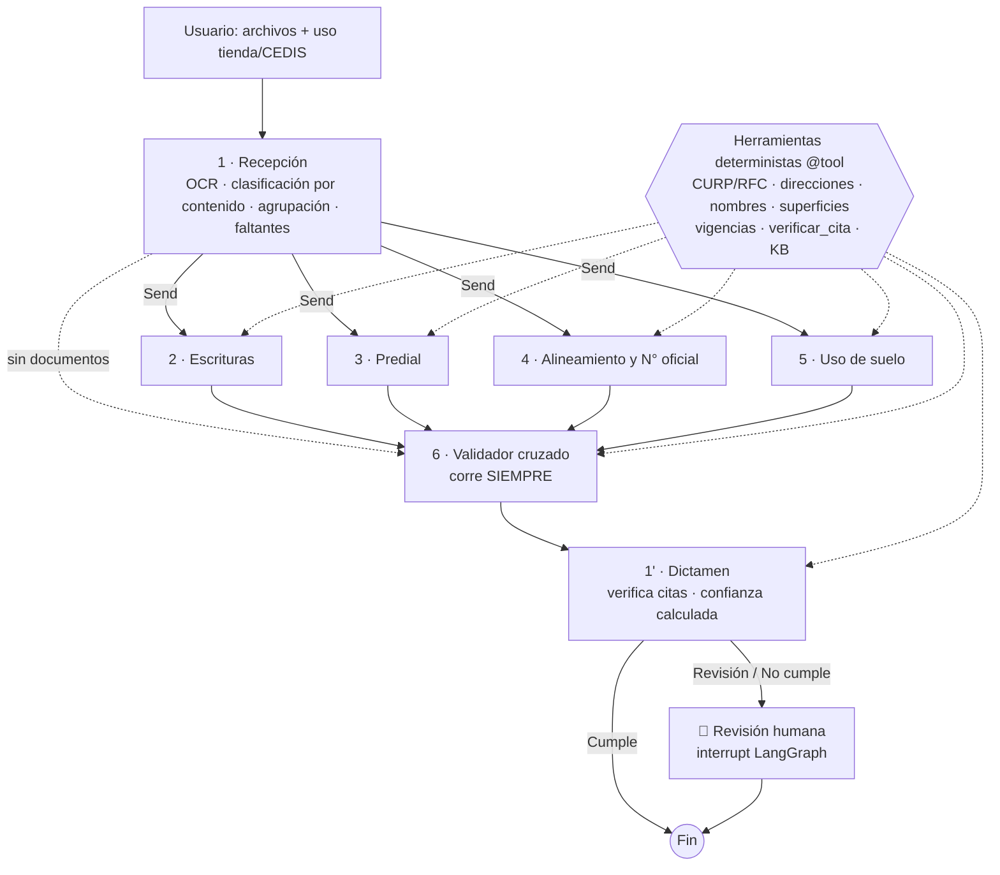

# Expedientes 3B · Revisión multiagente (Reto 1 · Hackatón Tiendas 3B)

Sistema multiagente (LangChain + LangGraph) que revisa el expediente legal de un inmueble, detecta faltantes e
inconsistencias, cruza la información entre documentos y emite **✅ Cumple / ⚠️ Requiere revisión / ❌ No cumple**,
con evidencia trazable (documento + página + fragmento verificado) en cada hallazgo.

## Arranque rápido

```powershell
.venv\Scripts\activate
copy .env.example .env            # y coloca OPENAI_API_KEY
python -m tests.generar_ejemplos  # expedientes sintéticos de prueba
streamlit run app.py              # prototipo (sube PDFs o usa un ejemplo)
```

CLI:

```powershell
python -m expediente.cli analizar ejemplos\problemas --uso tienda    # → salida\problemas.md / .json
python -m expediente.cli agrupar datos\ --analizar                    # datos del reto vienen por TIPO: los reagrupa por inmueble
python -m expediente.cli diagrama                                     # → salida\grafo.mmd / grafo.png
python -m pytest -q tests
```

Requisitos externos: Tesseract con idioma `spa` (ruta en `TESSERACT_CMD`).

## Arquitectura



| Agente | Archivo | Qué hace |
|---|---|---|
| Recepción | [expediente/agents/recepcion.py](expediente/agents/recepcion.py) | Descarta no-documentos y duplicados, OCR, clasifica por contenido (palabras clave del YAML + LLM), extrae huella y agrupa por inmueble |
| Especialistas ×4 | [expediente/agents/especialistas.py](expediente/agents/especialistas.py) | Extracción estructurada `{valor, página, fragmento}`, reglas del YAML, consulta de KB, estado de 3 valores + motivos |
| Validador cruzado | [expediente/agents/validador.py](expediente/agents/validador.py) | Dirección, número oficial, propietario (escritura↔predial), superficie, clave catastral, documentos de otro inmueble |
| Dictamen | [expediente/agents/dictamen.py](expediente/agents/dictamen.py) | Verifica cada cita contra el OCR, calcula confianza, aplica reglas de dictamen, human in the loop |

### Decisiones clave
- **Reglas en configuración, no en prompts**: [config/reglas/*.yaml](config/reglas/) (campos, reglas críticas/menores, vigencias) y [config/dictamen.yaml](config/dictamen.yaml) (umbral, pesos, usos compatibles, tolerancias). Cambiar a las reglas oficiales no toca código.
- **Nada se corta antes de tiempo**: si falta un documento o un especialista falla, el resultado es *Requiere revisión* y el validador cruzado corre igual.
- **No cumple solo con evidencia clara y verificada**: uso de suelo incompatible por palabras clave, o documento de otro inmueble con ≥2 señales independientes. Un juicio del LLM nunca rechaza por sí solo; un incumplimiento cuya cita no se verifica baja a *Requiere revisión*.
- **Anti-alucinación**: cada fragmento citado se busca en el texto OCR (fuzzy ≥ 85, todas las páginas si la página citada no cuadra).
- **Confianza calculada**: calidad OCR, % campos obligatorios, % reglas que pasan, score de cruces y % de citas verificadas (pesos en YAML). Con faltantes nunca supera el umbral.
- **CURP/RFC**: formato + dígito verificador; corrige confusiones típicas del OCR (O↔0, I↔1…) y lo deja anotado.
- **Predial a nombre de otra persona** = discrepancia menor (*Requiere revisión*), no rechazo.
- **KB por especialista** ([kb/](kb/)): contexto, no prueba de autenticidad. Altas automáticas quedan como *Pendientes* y se guardan sin datos personales.

## Motor OCR (elegible)
Selector en la barra lateral de la app, `--ocr tesseract|vision` en la CLI, o `OCR_MOTOR=` en `.env`.

| | Tesseract (sin IA, por defecto) | Visión (IA) |
|---|---|---|
| Dónde corre | Local | Imágenes de páginas al proveedor del LLM |
| Costo / velocidad | Gratis, rápido | Costo por página, más lento |
| Calidad | Confianza real por palabra; falla en escaneos malos (O↔0, I↔1) | Mejor en escaneos difíciles; puede "completar" texto ilegible |
| Calidad OCR reportada | Medida | Fija en 90% (no medida) |
| Si falla | — | Cae a Tesseract por página |

La caché por hash distingue el motor.

Uso: `python -m expediente.cli agrupar archivos_prueba --ocr vision`
