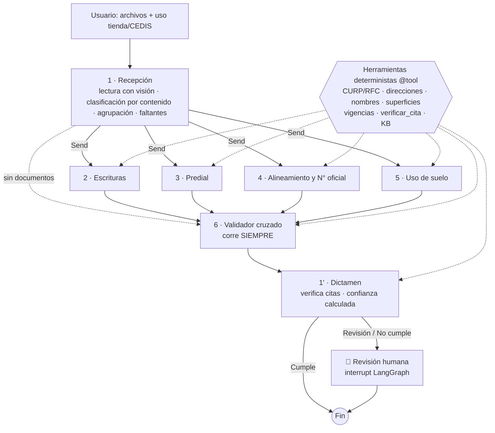

# Expedientes 3B · Revisión multiagente (Reto 1 · Hackatón Tiendas 3B)

Sistema multiagente (LangChain + LangGraph) que revisa el expediente legal de un inmueble, detecta faltantes e
inconsistencias, cruza la información entre documentos y emite **✅ Cumple / ⚠️ Requiere revisión / ❌ No cumple**,
con evidencia trazable (documento + página + fragmento verificado) en cada hallazgo.

## Arranque rápido

```powershell
.venv\Scripts\activate
copy .env.example .env            # LLM_PROVIDER=ollama (local) u openai + OPENAI_API_KEY
python -m tests.generar_ejemplos  # expedientes sintéticos de prueba
streamlit run app.py              # prototipo (sube PDFs o usa un ejemplo)
```

CLI:

```powershell
python -m expediente.cli analizar ejemplos\problemas --uso tienda    # → salida\problemas.md / .json
python -m expediente.cli agrupar datos\ --analizar                    # datos del reto vienen por TIPO: los reagrupa por inmueble
python -m expediente.cli diagrama                                     # → salida\grafo.mmd / grafo.png
python -m pytest -q tests
```

Requisitos externos (modo local): [Ollama](https://ollama.com) con un modelo con visión: `ollama pull qwen2.5vl:3b`.

## Arquitectura



| Agente | Archivo | Qué hace |
|---|---|---|
| Recepción | [expediente/agents/recepcion.py](expediente/agents/recepcion.py) | Descarta no-documentos y duplicados, lee el texto (capa nativa o LLM con visión), clasifica por contenido (palabras clave del YAML + LLM), extrae huella y agrupa por inmueble |
| Especialistas ×4 | [expediente/agents/especialistas.py](expediente/agents/especialistas.py) | Extracción estructurada `{valor, página, fragmento}`, reglas del YAML, consulta de KB, estado de 3 valores + motivos |
| Validador cruzado | [expediente/agents/validador.py](expediente/agents/validador.py) | Dirección, número oficial, propietario (escritura↔predial), superficie, clave catastral, documentos de otro inmueble |
| Dictamen | [expediente/agents/dictamen.py](expediente/agents/dictamen.py) | Verifica cada cita contra el texto leído, calcula confianza, aplica reglas de dictamen, human in the loop |

### Decisiones clave
- **Reglas en configuración, no en prompts**: [config/reglas/*.yaml](config/reglas/) (campos, reglas críticas/menores, vigencias) y [config/dictamen.yaml](config/dictamen.yaml) (umbral, pesos, usos compatibles, tolerancias). Cambiar a las reglas oficiales no toca código.
- **Nada se corta antes de tiempo**: si falta un documento o un especialista falla, el resultado es *Requiere revisión* y el validador cruzado corre igual.
- **No cumple solo con evidencia clara y verificada**: uso de suelo incompatible por palabras clave, o documento de otro inmueble con ≥2 señales independientes. Un juicio del LLM nunca rechaza por sí solo; un incumplimiento cuya cita no se verifica baja a *Requiere revisión*.
- **Anti-alucinación**: cada fragmento citado se busca en el texto leído (fuzzy ≥ 85, todas las páginas si la página citada no cuadra).
- **Confianza calculada**: % campos obligatorios, % reglas que pasan, score de cruces y % de citas verificadas (pesos en YAML). Con faltantes nunca supera el umbral.
- **CURP/RFC**: formato + dígito verificador; corrige confusiones típicas de lectura (O↔0, I↔1…) y lo deja anotado.
- **Predial a nombre de otra persona** = discrepancia menor (*Requiere revisión*), no rechazo.
- **KB por especialista** ([kb/](kb/)): contexto, no prueba de autenticidad. Altas automáticas quedan como *Pendientes* y se guardan sin datos personales.

## Lectura de documentos (sin OCR clásico)
- **PDF digital** (trae capa de texto): se usa esa capa tal cual, exacta e instantánea.
- **Escaneo o imagen**: la página se reduce a `lado_max_px` (1280 px) y la transcribe el **LLM con visión**: el mismo
  modelo que corre los agentes (`OLLAMA_MODEL`; opcionalmente otro en `OLLAMA_VISION_MODEL`) o el de OpenAI.
- La caché por hash distingue proveedor, modelo y tamaño de imagen. Si una página no se pudo leer, no se cachea.
- No hay métrica de "calidad OCR": la confianza sale de campos, reglas, cruces y citas verificadas.

### Rendimiento local (GPU de 4 GB)
- `qwen2.5vl:3b` cabe completo en VRAM; un 7B no (≈60 % corre en CPU, ~8 tok/s).
- Variables de Ollama recomendadas: `OLLAMA_FLASH_ATTENTION=1`, `OLLAMA_KV_CACHE_TYPE=q8_0`, `OLLAMA_MAX_LOADED_MODELS=1`.
- En `.env`: `OLLAMA_NUM_CTX=12288` y `OLLAMA_KEEP_ALIVE=30m` (el modelo no se descarga entre documentos).

## Varios usuarios al mismo tiempo
Medido con `qwen2.5vl:3b` en una RTX 3050 Ti (4 GB): **1 análisis solo = 98 s; 2 intercalados = 326 s cada uno**.
Ollama atiende una petición a la vez y, al alternar entre usuarios, pierde el contexto ya procesado del otro, así
que mezclar es peor que esperar turno.

Qué hace la app ([expediente/fila.py](expediente/fila.py)):
- **Fila FIFO compartida** por todas las sesiones, con capacidad por proveedor (`FILA_OLLAMA=1`, `FILA_OPENAI=4`).
  Con 2 usuarios en local: el 1º termina a los ~93 s y el 2º a los ~170 s (antes, ambos a los 326 s).
- El usuario en espera ve su **posición y la espera estimada** (promedio de los últimos análisis) y puede
  **mandar su análisis a OpenAI** con un botón si hay `OPENAI_API_KEY`.
- Si mueve algo de la página mientras espera, **conserva su lugar**. Si cierra la pestaña, su turno **caduca** en
  ~20 s y no bloquea a nadie. Si un análisis se interrumpe, el lugar se libera.
- **Ajustes por sesión**: proveedor y modelo viven en un `ContextVar` por sesión (antes en `os.environ`, global:
  un usuario le cambiaba el modelo a otro a media corrida).
- **Caché de lectura segura**: escritura atómica y un candado por archivo; si dos usuarios suben el mismo PDF,
  la GPU lo lee una sola vez.

Límites conocidos (aceptables para el hackatón):
- La fila vive en memoria de **un** proceso de Streamlit: la CLI u otra instancia de la app no la ven.
- Los resultados (`InMemorySaver`) se pierden al reiniciar y crecen con cada análisis.

### Cómo escalaría a muchos usuarios
| Pieza | Hackatón (hoy) | Producción |
|---|---|---|
| Interfaz | Streamlit ejecuta el análisis en el hilo de la sesión | Frontend + API (FastAPI) que solo encola y consulta estado |
| Cola | `Fila` en memoria | Redis + workers (RQ/Celery/Arq); reintentos, prioridades, tiempos límite |
| Modelo | Ollama, 1 GPU de 4 GB, 1 petición a la vez | vLLM/TGI en GPU(s) de 24 GB+ con *continuous batching* (decenas de peticiones a la vez) o API en la nube; desborde automático a la nube cuando la cola crece |
| Estado | `InMemorySaver` | Checkpointer de LangGraph en Postgres (sobrevive reinicios, permite HITL días después) |
| Archivos | `.cache/` local | Almacenamiento de objetos (S3/Blob) con caché de lectura por hash compartida |

## Frontend Next.js (`frontend/`)

Frontend de expedientes (Next.js). El código está en la carpeta `frontend/`.

## Instalación y ejecución

Desde `frontend/`:

```bash
cd frontend
npm install
npm run build
npm run start
```

La aplicación queda en http://localhost:3000.

Si hace falta apuntar a un backend, copia `frontend/.env.example` a `frontend/.env.local` antes de instalar y correr.
